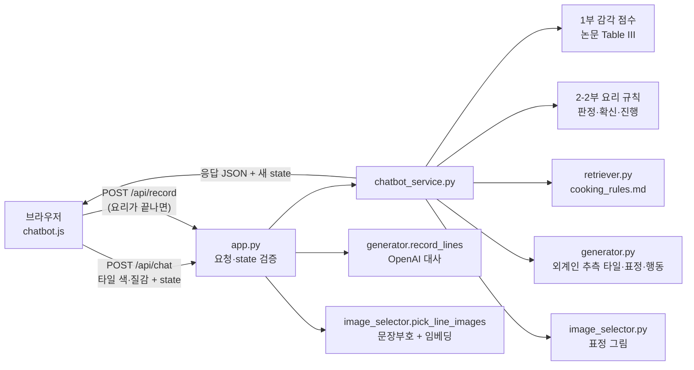

# Noizilien (노이질리언)

보이저호의 골든 레코드에서 지구 요리를 보고 따라 만들다 실패한 외계인 요리사를 돕는 캐릭터 챗봇 게임입니다.
외계인은 지구 말을 모릅니다. 그래서 **말 대신 색과 질감이 담긴 타일**을 주고받으며 재료 선정부터 플레이팅까지 요리를 완성합니다.

- 공개 URL: <https://noizilien.onrender.com> (`main` 브랜치를 자동 배포. 무료 플랜이라 처음 열 때 30초~1분 걸릴 수 있음)
- 팀 규칙과 현재 진행 상황: [AGENTS.md](AGENTS.md)

## 프로젝트 소개

- **누구를 위한 서비스인가:** 글 대신 색·질감으로 감정을 전하는 경험을 해 보고 싶은 사람
- **어떤 대화인가:** 사용자가 색 선택기와 크기·밀도 막대로 학종이 같은 타일을 만들어 보내면, 외계인이 그 타일을 읽고 요리하며 표정과 몸짓, 자기 추측 타일로 답합니다. 게임 화면에는 한국어 설명이 없습니다.
- **감각의 근거:** 색·질감과 감정의 관계는 Lucassen, Gevers, Gijsenij (2011) "Texture Affects Color Emotion"의 Table III 공식을 따릅니다. 규칙 번호(R1~R15)와 근거는 [data/knowledge/paper_rules.md](data/knowledge/paper_rules.md)에 있습니다.

## 화면 미리보기

> 스크린샷 추가 예정: 첫 화면 / 이름·성별 선택 / 진행 화면(가로·세로) / 결과 화면(요리 + 골든 레코드)

## 주요 기능

### 1. 시작
- 첫 화면 → 이름 입력, 남성·여성 플레이어 선택 → 진행 화면
- 고른 플레이어가 진행 화면 기록 칸의 "나" 아이콘이 됩니다.

### 2. 요리 4단계 (한 단계 = 한 턴, 한 턴 안에서 타일을 여러 번 주고받음)

| 단계 | 판정에 쓰는 값 | 무엇을 정하나 |
|---|---|---|
| 재료 선정 | 색 온도 + 노이즈 | **첫 타일 하나로 메뉴를 정함.** 따뜻+거침=피자, 차가움+거침=햄버거, 차가움+고움=라멘, 따뜻+고움=오므라이스. 메뉴는 끝날 때까지 사용자에게 보이지 않음 |
| 손질 | 손질 크기, 거침 | 너무 잘게(under) / 너무 크게(over) / 칼질이 거칢(unstable) |
| 조리 | 조리 온도감, 노이즈 불안정성 | 덜 익음(under) / 탐(over) / 겉과 속이 고르지 않음(unstable) |
| 플레이팅 | 색상(Hue, 원형 범위) | 범위를 벗어나면 abnormal (파란 피자 같은 결과) |

- 서버가 타일마다 `success / under / over / unstable`을 판정하고 외계인의 **확신(0~1)**을 갱신합니다.
- 확신이 기준 이상이면 다음 단계로 넘어가고, 미만이면 같은 단계를 다시 요청합니다(화면에 ↻와 남은 시도 점).
- 단계마다 최대 3번이며, 다 쓰면 마지막 타일로 결과를 확정합니다.
- 외계인이 틀린 조리에 자신만만할 수도 있습니다. 이 어긋남의 정도(`bluff`)는 config로 조정합니다.
- 왼쪽 아래 **?**에 마우스를 올리면 "재료들을 보아하니 이런 걸 만들 수 있을 거 같아~"와 함께 만들 수 있는 요리 4개가 보입니다.

### 3. 외계인 반응
- 표정 6종(default, doubt, convinced, surprised, thinking, joy)이 판정과 확신에 따라 바뀌고, 판정마다 몸짓 애니메이션이 한 번 나옵니다.
- 머리 옆 말풍선에 방금 받은 타일이 뜨고, 확신이 오를수록 빨리 깜박입니다.
- 단계가 끝나면 두 사람의 타일이 기록 칸(윗줄 외계인, 아랫줄 나)으로 날아갑니다.
- 단계마다 배경(재료 준비, 손질, 조리, 플레이팅)이 바뀝니다.
- ↺는 방금 보낸 타일을 취소합니다.

### 4. 결과 화면: 요리 + 골든 레코드
- 세 단계가 모두 성공하면 성공 요리, 아니면 실패 요리 그림을 보여 줍니다. 플레이팅에서 고른 색만큼 요리 그림의 색을 돌립니다.
- 주고받은 타일을 골든 레코드의 나선 홈에 12시부터 시계방향으로 새깁니다.
- 홈에 마우스를 올리면 그 타일을 말로 옮긴 대사가 뜹니다(OpenAI, 키가 없으면 준비된 대사). 외계인 대사에는 감정에 맞는 표정 그림이 붙습니다(OpenAI 임베딩).

### 5. 반응형
- **가로 화면:** 1920×1080 무대를 창 크기에 맞춰 비례 확대·축소합니다. 남는 곳은 여백입니다.
- **세로 화면:** 외계인은 배경 창 안에 두고, 타일 패널은 아래로 내립니다. 누르는 요소는 최소 44px입니다.
- 캔버스는 기기 픽셀 비율(devicePixelRatio)에 맞춰 다시 그려 흐려지지 않습니다.

## 아키텍처와 데이터 흐름



1. 브라우저가 타일 원본 데이터(`color {L,C,h}`, `texture {oct,freq,pers,lac}`, `seed`)를 보냅니다.
2. **판정은 서버가 합니다.** 서버는 브라우저가 계산한 점수를 믿지 않고, 색·질감 값으로 다시 계산합니다.
3. 진행 상태(`state`)는 서버에 저장하지 않습니다. 브라우저가 들고 다니고, 서버는 받을 때마다 `app.py`의 `parse_state`로 검증합니다. 그래서 ↺(되돌리기)는 이전 state를 다시 보내는 것만으로 됩니다.
4. 화면은 서버가 돌려준 값(`stage`, `verdict`, `retry`, `attempts_left`, `plating` 등)을 그리기만 합니다.

| 하는 일 | 파일 |
|---|---|
| 캐릭터·단계·요리·판정 기준표·확신 계수 (숫자는 전부 여기) | [config/chatbot_config.json](config/chatbot_config.json) (`game` 블록) |
| 감각 점수(1부), 단계 규칙(2부), 요리 게임 규칙(2-2부), 응답 조립(3부) | [services/chatbot_service.py](services/chatbot_service.py) |
| 외계인 추측 타일·표정·행동 묘사, 레코드 대사 | [services/generator.py](services/generator.py) |
| 요리 지식 검색 | [services/retriever.py](services/retriever.py) + [data/knowledge/cooking_rules.md](data/knowledge/cooking_rules.md) |
| 표정·레코드 대사 그림 선택 | [services/image_selector.py](services/image_selector.py) |
| 라우팅·요청 검증 | [app.py](app.py) |
| 화면 | [templates/](templates/), [public/assets/css/style.css](public/assets/css/style.css), [public/assets/js/chatbot.js](public/assets/js/chatbot.js) |

API 계약(요청·응답 필드)은 [AGENTS.md의 "코드 구조에서 지킬 것"](AGENTS.md)에 있습니다.

## 기술 스택과 선택 이유

| 기술 | 선택 이유 |
|---|---|
| Flask (Python 3.12) | 베이스 코드 구조를 그대로 쓰고, 감각 공식·판정 규칙을 서버 한곳에서 계산하기 위해 |
| HTML/CSS/바닐라 JS (빌드 도구 없음) | 화면이 한 장이고 캔버스(펄린 노이즈 타일, 색 선택기, 레코드)를 직접 그리므로 프레임워크가 필요 없음 |
| Canvas 2D 펄린 노이즈 | 질감 = 노이즈 파라미터(옥타브·주파수·지속성·공극성)가 논문 공식의 입력이라, 같은 값으로 그림과 점수를 함께 만들 수 있음 |
| OpenAI `gpt-6-luna` (추론 강도 `none`) | 결과 레코드의 타일 대사 생성. 외계인 말투와 요리 흐름을 지키는 데 이 강도로 충분했음 |
| OpenAI `text-embedding-3-small` | 레코드 외계인 대사와 표정 그림 설명을 비교해 감정에 맞는 그림을 고름 |
| Render (무료 웹 서비스) | `main`에 merge하면 자동 배포되어 팀이 같은 주소로 확인 가능 |

- **쓰지 않은 것: 벡터 DB(ChromaDB 등)** — 지식 문서가 요리 4개 × 단계 4개 = 16조각뿐이고, 묻는 말도 "메뉴 단계 판정"으로 정해져 있습니다. 그래서 제목 단어 일치로 충분했습니다. 문서가 커지면 임베딩 검색으로 바꿀 자리입니다(`retriever.py`).

## 실행 및 테스트

```bash
conda create -n noizilian python=3.12 pip
conda activate noizilian
python -m pip install -r requirements.txt
python app.py            # → http://localhost:5000
```

Docker를 쓸 때는 `docker compose up --build` → <http://localhost:5001>입니다. 팀 환경 정리는 [ENVIRONMENT.txt](ENVIRONMENT.txt)에 있습니다.

**환경 변수** (프로젝트 맨 위 `.env`, 커밋 금지)

| 이름 | 값 |
|---|---|
| `OPENAI_API_KEY` | 운영진이 준 키 |
| `OPENAI_MODEL` | `gpt-6-luna` |
| `OPENAI_REASONING_EFFORT` | `none` |
| `LLM_PER_IP_PER_10MIN` | IP별 10분 외계인 판단 호출 한도. 기본 `40` |
| `RECORD_PER_IP_PER_10MIN` | IP별 10분 레코드 대사 호출 한도. 기본 `5` |
| `LLM_DAILY_LIMIT` | 서버 전체 하루(UTC) 호출 한도. 기본 `1500` |
| `GAME_LOG` | `1`이면 타일마다 단계·시도·적합도·일관성·판단 출처·진행 여부를 서버 로그에 남김 |

한도를 넘으면 오류 없이 그 요청만 규칙으로 대체합니다(`decision_source`, 레코드 `source`가 `rule_limited`). 제한은 메모리에 세므로 서버가 재시작되면 초기화되고, worker 1개 기준입니다.

**호출 수와 예상 비용** (`gpt-6-luna` 입력 $0.10·출력 $0.50, `text-embedding-3-small` $0.02, 1M 토큰당)

| 호출 | 한 판 횟수 | 예상 비용 |
|---|---|---|
| 외계인 판단 | 타일마다 1번 (최대 40번) | 타일당 약 $0.00012 (입력 약 910·출력 약 58 토큰) |
| 레코드 대사 | 1번 | 약 $0.0016 (입력 약 11,600·출력 약 920 토큰) |
| 임베딩 | 1번 (표정이 없는 타일이 있으면 2번) | 약 $0.00013 |

실제 10판(평균 타일 12.8장) 측정으로 한 판 약 $0.0033입니다. 타일 40장이면 약 $0.007로 추정합니다.

키가 없어도 게임은 끝까지 돌아갑니다. 이때 레코드 대사는 `data/knowledge/record_lines.md`에서 타일 태그(단계·판정·오해 등)로 골라 쓰고, 그림은 문장부호 규칙으로만 고릅니다.

**테스트**

```bash
python -m unittest discover -s tests -v
```

[tests/test_smoke.py](tests/test_smoke.py)가 확인하는 것:
- 논문 공식이 브라우저 쪽 계산과 같은지
- 메뉴 4개 결정, 요리 × 단계 × 판정 4종, 피자 Hue 경계(344·345·0·45·46°)
- 최대 시도에서 결과 확정, 기존 응답 필드 유지
- 레코드 대사와 그림 선택

테스트는 `.env`에 키가 있어도 OpenAI를 부르지 않습니다.

**한 판 해 보기 — 메뉴별 첫 타일**

| 메뉴 | 색 (색상 막대) | 밀도 막대 (두 번째) |
|---|---|---|
| 피자 | 빨강 (맨 왼쪽) | 오른쪽 80% |
| 햄버거 | 파랑 (약 60% 지점) | 오른쪽 80% |
| 라멘 | 파랑 | 왼쪽 20% |
| 오므라이스 | 빨강 | 왼쪽 20% |

- 판정값은 개발자 도구(F12) → Network → `chat` 응답의 `verdict`, `metrics`에서 볼 수 있습니다.
- 판정 기준표와 확신 계수는 `config.game.rules`, `config.game.confidence`에서 코드 수정 없이 바꿀 수 있습니다.

## 개발 중 문제와 해결

| 문제 | 원인 | 해결 |
|---|---|---|
| 레코드 외계인 대사에 엉뚱한 표정 그림이 붙음 (대부분 "놀람") | 대사와 그림 설명 한 줄의 임베딩만 비교했는데, 임베딩이 `?`와 `!`를 잘 구분하지 못함 | ① 문장부호로 후보 표정을 먼저 좁힘(`?!` 놀람, `?` 의심·고민, `!` 기쁨·확신·놀람). ② 표정마다 외계인 말투 예시 대사를 여러 개 두고 가장 비슷한 예시와 비교 |
| 같은 표정 그림만 반복됨 | GPT가 외계인 대사를 거의 다 질문으로 씀 | 대사 지시문에 감정 6가지와 흐름을 넣고, 이미 쓴 표정은 점수를 깎아 고루 섞음(`pick_diverse`) |
| ✓를 누른 뒤 다음으로 넘어가기까지 3~6초 | 타일마다 OpenAI로 외계인 판단을 기다림 | 기다리는 동안 머리 위 말풍선이 보임. 8초가 넘으면 규칙으로 대체. `config.game.llm_decide`로 끌 수 있음 |
| 첫 시도에 완벽한 타일을 보내도 다음 단계로 안 넘어감 | 단계가 시작될 때 확신이 0인데, 이전 확신을 섞는 계산이 첫 시도에도 적용됨 | 이전 확신은 같은 단계의 두 번째 시도부터만 섞음 |
| 색상 막대가 무지개가 아니라 회색 | 브라우저 기본 슬라이더 모양이 배경색을 무시함 | `appearance: none`으로 기본 모양을 끄고 손잡이를 직접 그림 |
| 화면 크기에 따라 배치가 깨짐 | 고정 픽셀 배치 | 가로는 고정 무대 + 비례 배율, 세로는 다른 배치. 외계인은 배경 창 비율에 맞춰 고정. 클릭 좌표는 화면 위 크기 비율로 계산해 배율과 상관없이 맞음 |
| 팀원 브랜치와 같은 파일(되돌리기, 반응형)을 반대로 고쳐 충돌 | 화면 파일을 동시에 수정 | 되돌리기(보낸 타일 취소)·말풍선 연출은 가져오고 반응형은 이쪽을 남기는 것으로 정해 merge |

## 개선 결과와 검증 방법

측정한 것만 적습니다.

- **레코드 표정 그림 정확도:** 외계인 말투 시험 대사 18개(직접 작성, 기대 감정 표시)로 비교했습니다.
  - 설명 한 줄 임베딩: **6/18**
  - 예시 대사 + 문장부호 규칙: **17/18**
  - 키가 없을 때 문장부호만: 10/18
  - 실제 GPT 대사로는 정확도를 재지 않았습니다. 12턴 대화 2번에서 표정 종류가 2~3가지에서 4~5가지로 늘어난 것만 확인했습니다.
- **타일 응답 시간:** 로컬, 키 있음 기준입니다.
  - 고치기 전: 메뉴 선택 타일 6.15초, 손질 타일 3.22초
  - 고친 뒤: 둘 다 0.01초 미만
- **플레이팅 Hue 복원:** 서버가 LCh에서 HSV 색상을 되찾을 때 생기는 오차입니다. 0~360°를 5° 간격으로 재 보니 최대 0.02°였습니다.
- **화면:** 헤드리스 Chrome으로 1920×1080, 1440×900, 2560×1080, 390×844, 768×1024, 360×640에서 가로 스크롤과 패널 넘침이 없는지 확인했습니다.

## 알려진 제한과 다음 개선점

- **외계인 응답의 일부가 아직 임시 규칙입니다.** 외계인이 내미는 추측 타일은 사용자 쪽으로 절반씩 다가가는 규칙입니다. 다음 작업은 `generator.py`의 `respond_to_tile`, `first_guess`를 GPT 호출로 바꾸는 것입니다.
- **거침과 노이즈 불안정성은 같은 값입니다.** 화면에 질감 막대가 크기·밀도 두 개뿐이라 둘 다 밀도에서 계산합니다. 판정하는 단계(손질 / 조리)가 달라서 겹치지는 않습니다.
- **외계인 행동 묘사(`alien_message`)는 화면에 보이지 않습니다.** "게임 화면에 글을 넣지 않는다"는 규칙 때문입니다.
- **플레이팅 색은 그림 전체의 색을 돌립니다.** 음식만 칠하지 않아서 접시 색도 바뀝니다.
- **기준값은 모두 초안입니다.** 판정 기준표, 확신 기준(0.7), 최대 시도(3번), 메뉴 경계(50)는 팀 확정이 필요합니다.
- **배포 서버에는 OpenAI 키가 없습니다.** 시연 전에 요청 횟수 제한을 건 뒤 Render 환경 변수에 키를 넣어야 합니다.
- **진행 중에도 응답에 메뉴가 들어 있습니다.** 메뉴는 화면에서는 숨기지만, 개발자 도구의 응답에는 `menu` 필드로 보입니다.

## 회고

> 팀이 작성: 구현과 협업에서 새로 배운 점, 다음에 다르게 해 볼 점

## 협업 규칙

- `main`에 직접 커밋하지 않습니다. 브랜치 → PR → 리뷰 → merge 순서로 진행합니다.
- 커밋 메시지는 `feat / fix / docs / test / refactor / style / chore`로 시작합니다.
- `.env`와 API 키는 커밋하지 않습니다.
- 새 라이브러리는 먼저 팀에 묻고, [requirements.txt](requirements.txt)와 [ENVIRONMENT.txt](ENVIRONMENT.txt)를 같이 고칩니다.
- 감각 공식은 `chatbot_service.py` 1부와 `chatbot.js` 두 곳에 있으니 한쪽을 고치면 다른 쪽도 고칩니다.

베이스 코드의 일반 안내(배포, Docker, 모델 연결 등)는 [docs/](docs/)에 그대로 있습니다.
