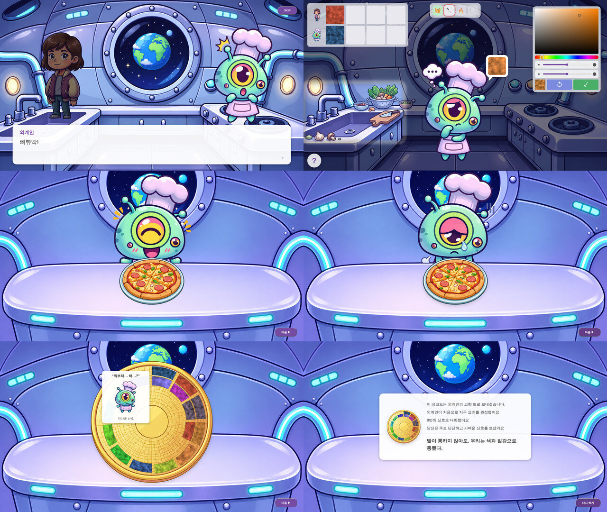
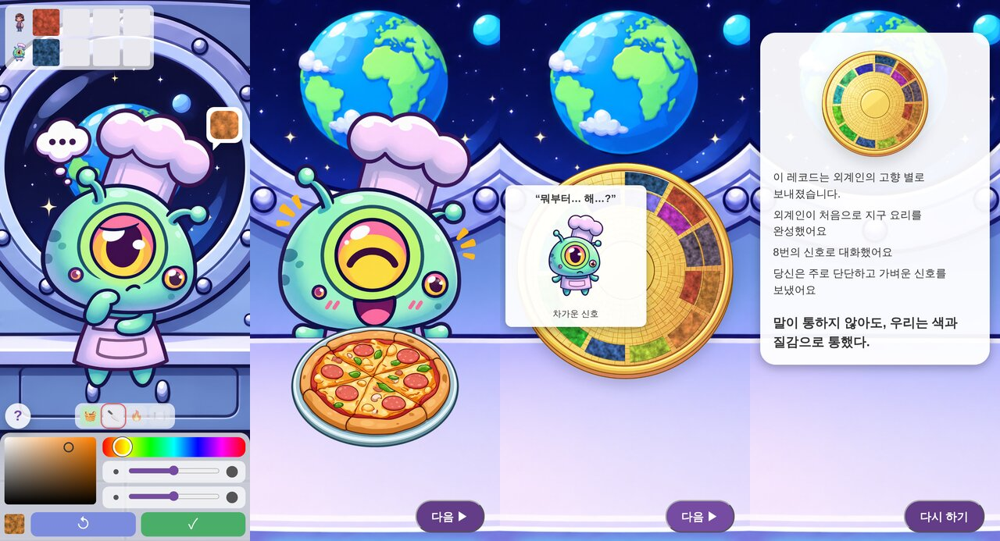
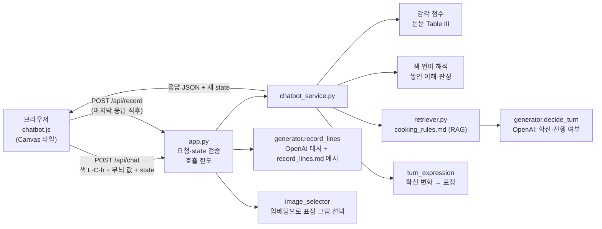

# NOIZILIEN (노이질리언)

보이저호의 골든 레코드에서 지구 요리를 보고 따라 만들다 실패한 외계인 요리사를 돕는 캐릭터 챗봇 게임입니다.
외계인은 지구 말을 모릅니다. 그래서 **말 대신 색과 질감이 담긴 타일**을 주고받으며 재료 선정부터 플레이팅까지 요리를 완성합니다.

- 공개 URL: <https://noizilien.onrender.com> (`main` 브랜치를 자동 배포. 무료 플랜이라 처음 열 때 30초~1분 걸릴 수 있음)
- 팀 규칙과 자세한 진행 기록: [AGENTS.md](AGENTS.md)

## 프로젝트 소개

- **누구를 위한 서비스인가:** 말이 아닌 색과 질감으로 마음을 전하는 경험을 해 보고 싶은 사람
- **어떤 대화인가:** 사용자가 색과 무늬(크기·밀도)를 골라 타일을 만들어 보내면, 외계인은 받은 타일을 쌓아 가며 알아듣고 **자기가 이해한 색의 타일과 표정**으로 답합니다. 외계인은 말하지 않고, 게임 화면에는 한국어 설명이 없습니다.
- **엔딩:** 네 단계가 끝나면 완성된 요리(성공 또는 실패)와 함께, 주고받은 타일이 새겨진 골든 레코드를 받습니다. 타일에 마우스를 올리면 그 타일을 말로 옮긴 대사가 나옵니다.
- **감각의 근거:** 색·질감이 주는 감각은 Lucassen, Gevers, Gijsenij (2011) "Texture Affects Color Emotion" Table III 공식으로 계산합니다. 근거 정리는 [data/knowledge/paper_rules.md](data/knowledge/paper_rules.md)에 있습니다.

## 화면 미리보기

**PC (1920×1080)**: 인트로 → 게임 진행 / 결과 ① 요리(성공·실패) / ② 골든 레코드(타일에 마우스를 올린 모습) → ③ 결론 카드



**모바일 (390×844)**: 게임 진행 → 결과 요리 → 골든 레코드 → 결론 카드



## 주요 기능

### 1. 시작과 인트로
- 첫 화면 → 이름 입력, 남성·여성 플레이어 선택 → 인트로
- 인트로는 비주얼 노벨처럼 주인공과 외계인의 초상화, 하단 대화창으로 진행합니다. 화면을 누르면 다음 줄로 넘어가고 SKIP으로 건너뛸 수 있습니다. 처음 한 번만 나옵니다.

### 2. 요리 4단계

| 단계 | 타일이 뜻하는 것 | 정해지는 것 |
|---|---|---|
| 재료 선정 | 타일 하나 = 재료 하나 | 쌓인 재료로 메뉴 결정 (햄버거·오므라이스·피자·라멘) |
| 손질 | 써는 방법과 크기·고르기 | 손질 판정 |
| 조리 | 조리 방법과 세기·고르기 | 조리 판정 |
| 플레이팅 | 접시에 입힐 색 | 메뉴마다 정해진 색 범위 안인지 (벗어나면 파란 피자 같은 결과) |

- **외계인의 색 언어** [앱 설정]: 색상(빨주노초파남보 7구간)은 종류·방법, 밝기·무늬는 정도를 뜻합니다.

  | 색 | 재료 | 손질 | 조리 |
  |---|---|---|---|
  | 빨 | 고기 | 깍둑썰기 | 굽기 |
  | 주 | 빵·곡물 | 채썰기 | 볶기 |
  | 노 | 달걀·치즈 | 다지기 | 부치기 |
  | 초 | 채소 | 저미기 | 데치기 |
  | 파 | 국물·물 | 어슷썰기 | 끓이기 |
  | 남 | 면 | 찢기 | 찌기 |
  | 보 | 소스 | 곱게 다지기 | 졸이기 |

- 한 단계 안에서 타일을 여러 번 주고받습니다. 외계인이 확신하면 다음 단계로 넘어가고, 단계마다 최대 10번입니다.
- 왼쪽 아래 **?**를 누르면 만들 수 있는 요리 4개를 힌트로 볼 수 있습니다. 지금 만드는 요리는 끝날 때까지 보이지 않습니다.

### 3. 외계인 반응 (말 대신 타일과 표정)
- **외계인 타일:** 매 턴 자기가 알아들은 색을 타일로 돌려줍니다. 머리 옆 말풍선에 뜹니다.
- **표정:** 확신이 오르면 확신(convinced), 내려가면 고민(thinking), 이해가 크게 바뀌면 놀람(surprised), 그대로면 의심(doubt). 같은 표정은 연달아 나오지 않습니다.
- **단계가 끝나면:** 확신 → 기쁨(joy) 표정으로 바뀌고, 두 사람의 타일이 왼쪽 위 기록칸으로 날아갑니다. 배경 속 다음 단계 물건이 잠깐 밝아집니다.
- **되돌리기(↺):** 방금 보낸 타일을 취소합니다.

### 4. 결과 화면 (세 장)
1. **요리:** 테이블 가운데 완성 요리, 뒤에 외계인(성공이면 `alien_success`, 실패면 `alien_fail`). 플레이팅 색이 요리 그림에 입혀집니다.
2. **골든 레코드:** 주고받은 타일을 나선 홈에 12시부터 시계방향으로 새깁니다. 타일에 마우스를 올리면 대사, 외계인 그림, 감각의 뜻이 나옵니다.
3. **결론 카드:** 소통 결과 요약과 다시 하기

### 5. 반응형
- **가로 화면:** 1920×1080 무대를 창 크기에 맞춰 비례 확대·축소합니다.
- **세로 화면:** 기록칸 → 외계인 → 타일 패널 순으로 쌓고, 누르는 요소는 최소 44px입니다.

## 아키텍처와 데이터 흐름



**타일 한 장의 흐름**
1. **타일 제시** [브라우저]: 사용자가 고른 색(CIELAB L·C·h)과 무늬(펄린 노이즈 값)를 보냅니다.
2. **감각 계산** [논문]: 서버가 논문 공식으로 감각 점수 4개(따뜻함, 강렬함, 단단함, 무거움)를 계산합니다. 브라우저가 계산한 점수는 믿지 않고 다시 계산합니다.
3. **의미 해석** [규칙]: 색 언어로 바꿉니다. 색상은 종류·방법, 밝기·무늬는 정도입니다.
4. **이해 누적** [규칙]: 받은 타일을 쌓아 이해합니다(새 타일 0.6 + 쌓인 값 0.4). 요리 목표에 맞는 정도(적합도)와 안정된 정도(일관성)를 계산합니다.
5. **반응 결정** [AI]: GPT가 적합도, 일관성, 받은 장 수, 남은 시도, 요리 규칙 문서(RAG)를 보고 확신(0~1)과 다음 단계 진행 여부를 정합니다. 표정은 확신 변화로 서버가 고릅니다. AI가 실패하면 규칙으로 대신합니다.
6. **결과** [규칙 + AI]: 성공·실패는 쌓인 신호를 규칙으로 판정합니다. 레코드 대사는 GPT가 쓰고, 대사에 맞는 외계인 그림은 임베딩으로 고릅니다.

**설계 원칙**
- **결과는 규칙, 외계인다움은 AI.** 같은 타일이면 언제나 같은 판정이 나오고, AI는 외계인이 얼마나 확신하는지와 언제 넘어갈지만 정합니다. 그래서 외계인이 잘못 알아듣고도 자신만만하게 넘어가는 장면이 생기고(한 판 최대 2번), 이 장면이 레코드의 오해 대사로 이어집니다.
- **진행 상태(state)는 서버에 저장하지 않습니다.** 브라우저가 들고 다니고 서버는 받을 때마다 `app.py`의 `parse_state`로 검증합니다. 되돌리기는 이전 state를 다시 보내는 것만으로 됩니다.

| 하는 일 | 파일 |
|---|---|
| 캐릭터·단계·요리·색 언어·판정 기준 (숫자는 전부 여기) | [config/chatbot_config.json](config/chatbot_config.json) |
| 감각 점수, 색 언어 해석, 쌓인 이해·판정, 표정, 응답 조립 | [services/chatbot_service.py](services/chatbot_service.py) |
| 외계인 판단(OpenAI), 레코드 대사 | [services/generator.py](services/generator.py) |
| 지식 검색 (요리 규칙, 대사 예시) | [services/retriever.py](services/retriever.py), [data/knowledge/](data/knowledge/) |
| 표정·레코드 그림 선택 | [services/image_selector.py](services/image_selector.py) |
| 라우팅·요청 검증·호출 한도 | [app.py](app.py) |
| 화면 | [templates/](templates/), [public/assets/css/style.css](public/assets/css/style.css), [public/assets/js/chatbot.js](public/assets/js/chatbot.js) |

API 계약(요청·응답 필드)은 [AGENTS.md의 "코드 구조에서 지킬 것"](AGENTS.md)에 있습니다.

## 기술 스택과 선택 이유

**엔지니어가 사용한 기술:** OpenAI API, Flask, HTML/CSS/JavaScript (Canvas), RAG, 임베딩, Render

**프로듀서가 사용한 툴:** (프로듀서 작성)

| 기술 | 맡은 일 | 선택 이유 |
|---|---|---|
| OpenAI `gpt-6-luna` + JSON 스키마 | 외계인 판단, 레코드 대사 | 빠르고 저렴함(판단 평균 2.4초, 한 판 약 $0.0033). 응답 형식을 고정해 서버가 값을 검사하고, 틀리면 규칙으로 대체 |
| RAG (`cooking_rules.md`, `record_lines.md`) | 판단 근거, 대사 예시 | 기획자가 문서만 고치면 바로 반영됨. 따로 학습시킬 필요 없음 |
| OpenAI `text-embedding-3-small` | 대사에 맞는 표정 그림 선택 | 문장부호만으로 고르면 18개 중 6개, 예시 대사와 임베딩을 비교하니 17개 맞음 |
| HTML/CSS/JS (Canvas) + Flask | 화면, 서버 | 베이스 코드 구조. 빌드 과정이 없어 팀원 누구나 바로 고칠 수 있고, 타일은 Canvas에 펄린 노이즈로 직접 그림 |

## 실행 및 테스트

```bash
conda create -n noizilian python=3.12 pip
conda activate noizilian
python -m pip install -r requirements.txt
python app.py            # → http://localhost:5000
```

Docker를 쓸 때는 `docker compose up --build` → <http://localhost:5001>입니다. 팀 환경 정리는 [ENVIRONMENT.txt](ENVIRONMENT.txt)에 있습니다.

**환경 변수** (프로젝트 맨 위 `.env`, 커밋 금지)

| 이름 | 값 |
|---|---|
| `OPENAI_API_KEY` | 운영진이 준 키 |
| `OPENAI_MODEL` | `gpt-6-luna` |
| `OPENAI_REASONING_EFFORT` | `none` |
| `LLM_PER_IP_PER_10MIN` | IP별 10분 외계인 판단 호출 한도. 기본 `40` |
| `RECORD_PER_IP_PER_10MIN` | IP별 10분 레코드 대사 호출 한도. 기본 `5` |
| `LLM_DAILY_LIMIT` | 서버 전체 하루(UTC) 호출 한도. 기본 `1500` |
| `GAME_LOG` | `1`이면 타일마다 단계·시도·적합도·일관성·판단 출처·진행 여부를 서버 로그에 남김 |

키가 없어도 게임은 끝까지 돌아갑니다. 외계인 판단은 규칙으로, 레코드 대사는 `record_lines.md` 예시로, 그림은 문장부호 규칙으로 대신합니다.

**호출 수와 비용** (실제 10판 측정, 평균 타일 12.8장)

| 호출 | 한 판 횟수 | 비용 |
|---|---|---|
| 외계인 판단 | 타일마다 1번 | 타일당 약 $0.00012 |
| 레코드 대사 | 1번 | 약 $0.0016 |
| 임베딩 | 1~2번 | 약 $0.00013 |
| **한 판 합계** | | **약 $0.0033** |

**테스트**

```bash
python -m unittest discover -s tests -v
```

[tests/test_smoke.py](tests/test_smoke.py)의 129개 테스트가 논문 공식(브라우저·서버 일치), 색 언어 해석, 단계 판정, 최대 시도, 표정 규칙, AI 판단과 규칙 대체, 호출 한도, 레코드 대사·그림 선택을 확인합니다. 테스트는 `.env`에 키가 있어도 OpenAI를 부르지 않습니다(AI 경로는 mock).

## 개발 중 문제와 해결

| 문제 | 원인 | 해결 |
|---|---|---|
| 무작위로 하면 성공률 0.15%, 따뜻한 색만 정답 | 논문 점수를 그대로 요리 판정에 연결함. 논문은 감각까지만 알려 주고 요리법은 알려 주지 않음 | 감각 계산(논문)과 요리 의미(색 언어 규칙)를 분리 |
| 빨강·파랑처럼 뚜렷한 색에만 정답이 몰림 | 감각 축이 따뜻함·차가움 쪽으로 치우침 | 색상을 7구간으로 나누고 단계마다 7색에 의미를 고르게 배분 |
| 타일 하나만 맞으면 되거나, 틀린 타일 하나로 전부 무너짐 | 마지막 타일만 보고 판정 | 받은 타일이 쌓이는 구조(새 타일 0.6 + 쌓인 값 0.4). 고쳐 보내는 중이면 일관성 감점 없음 |
| 라멘이 49%로 쏠림 | 국물(파랑) 재료는 네 메뉴 모두에 있고 면(남색) 구간이 넓었음 | 남색 구간을 225~265°로 좁힘 → 네 메뉴 각 23~27% |
| AI가 너무 성급하다가, 고친 뒤엔 너무 신중함 | 확신 기준이 고정됨 | 시도가 늘수록 기준을 낮추고, 틀린 채 넘어가기는 한 판 2번까지 → 단계당 중앙값 2번 |
| 진행 중 같은 표정만 반복 | 표정을 판정 방향으로만 고름 | 확신 변화로 고르고 직전 표정은 제외 → 네 표정 각 22~27%, 연속 0번 |
| 레코드 대사에 엉뚱한 표정 그림 | 임베딩이 `?`와 `!`를 잘 구분하지 못함 | 문장부호로 후보를 좁힌 뒤 표정별 예시 대사와 비교 → 6/18에서 17/18 |
| 레코드 대사에 일본어가 섞이고 오해·바로잡기 대사가 따로 놂 | GPT가 줄마다 따로 씀 | 오해와 바로잡기를 한 묶음으로 쓰게 하고, 규칙을 어긴 줄만 예시 대사로 교체 |
| 레코드 대사가 약 8초 걸림 | 타일 전체를 한 번에 GPT가 씀 | 마지막 응답 직후 미리 요청해 요리 화면을 보는 동안 생성. GPT에는 최근 48장만 |
| 공개 서버에서 비용 폭주 우려 | 누구나 API를 부를 수 있음 | IP별·하루 호출 한도. 넘으면 규칙으로 대체 |
| 팀원과 같은 화면 파일을 반대로 고쳐 충돌 | 화면 파일을 동시에 수정 | 기능 단위 브랜치로 묶어 작업하고, merge 전에 어느 쪽을 남길지 정함 |

## 개선 결과와 검증 방법

**검증 방법**
- **자동 테스트:** 129개. 코드를 고칠 때마다 실행
- **봇 시뮬레이션:** 규칙 경로로 봇 전략마다 3,000판(무작위로 보내는 봇, 정답 근처로 보내는 봇)
- **실제 AI 판:** 봇 2종 × 5판 = 10판. 교환 횟수, 응답 시간, 비용 실측
- **화면:** 헤드리스 Chrome으로 1920×1080, 1280×720, 390×844 등에서 배치 확인

**결과**

| 항목 | 고치기 전 | 고친 뒤 |
|---|---|---|
| 성공률 (무작위로 보냄) | 약 0.15% | 13~18% |
| 성공률 (정답 근처로 보냄) | 대부분 실패 | 62~76% (실제 AI 5판은 모두 성공) |
| 메뉴 빈도 (무작위) | 라멘 49% | 네 메뉴 각 23~27% |
| 단계당 교환 횟수 (실제 AI) | 첫 장에 넘어가거나 끝까지 감 | 중앙값 2번 (첫 장 통과 40%, 10번까지 2.5%) |
| 진행 중 표정 분포 (무작위 400판) | 같은 표정 반복 | 네 표정 각 22~27%, 연속 0번 |
| 레코드 표정 그림 정확도 (시험 대사 18개) | 6/18 | 17/18 |
| AI 판단 응답 시간 | | 평균 2.4초 (8초 넘으면 규칙 대체) |

## 알려진 제한과 다음 개선점

- **사람 플레이 테스트 전입니다.** 수치는 모두 봇 기준입니다. 5명 테스트(`GAME_LOG=1`)로 실제 교환 횟수와 성공률을 잴 예정입니다.
- **무작위로 보내면 대화가 길어집니다.** 단계당 중앙값 4번입니다. 테스트 결과를 보고 확신 기준을 조정합니다.
- **플레이팅이 가장 쉽습니다.** 무작위 성공률이 약 30%로 다른 단계(9~19%)보다 높습니다.
- **재료 단계는 확신 표정이 47%로 많습니다.** 다른 단계는 13~16%입니다. 단계별로 표정 기준을 따로 맞출 예정입니다.
- **레코드 대사는 약 8초 걸립니다.** 지금은 미리 요청해서 가리고 있습니다.
- **호출 한도는 서버 메모리에 셉니다.** 서버가 재시작되면 초기화되고 worker 1개 기준입니다.
- **플레이팅 색은 요리 그림 전체에 입힙니다.** 접시 색도 같이 바뀝니다.
- **색 언어는 게임 설계입니다.** 논문 근거는 감각 계산까지이고, 색과 요리법의 연결은 팀이 정한 규칙입니다.
- **Render 무료 플랜**이라 오래 안 쓰면 첫 접속이 느립니다.

## 회고

> 팀이 작성: 구현과 협업에서 새로 배운 점, 다음에 다르게 해 볼 점

## 협업 규칙

- `main`에 직접 커밋하지 않습니다. 브랜치 → PR → 리뷰 → merge 순서로 진행합니다.
- 커밋 메시지는 `feat / fix / docs / test / refactor / style / chore`로 시작합니다.
- `.env`와 API 키는 커밋하지 않습니다.
- 새 라이브러리는 먼저 팀에 묻고, [requirements.txt](requirements.txt)와 [ENVIRONMENT.txt](ENVIRONMENT.txt)를 같이 고칩니다.
- 감각 공식은 `chatbot_service.py`와 `chatbot.js` 두 곳에 있으니 한쪽을 고치면 다른 쪽도 고칩니다.

베이스 코드의 일반 안내(배포, Docker, 모델 연결 등)는 [docs/](docs/)에 그대로 있습니다.
